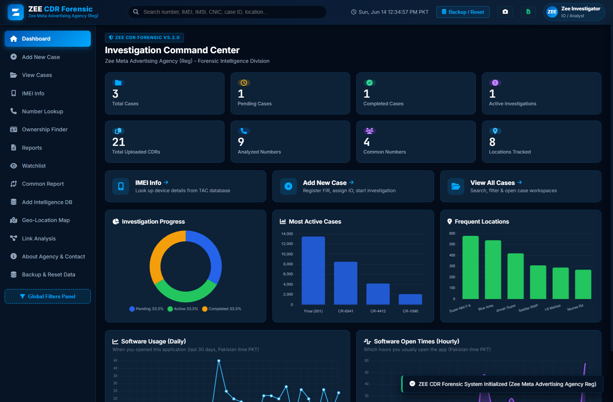
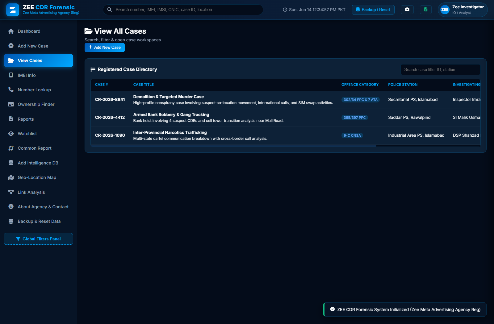
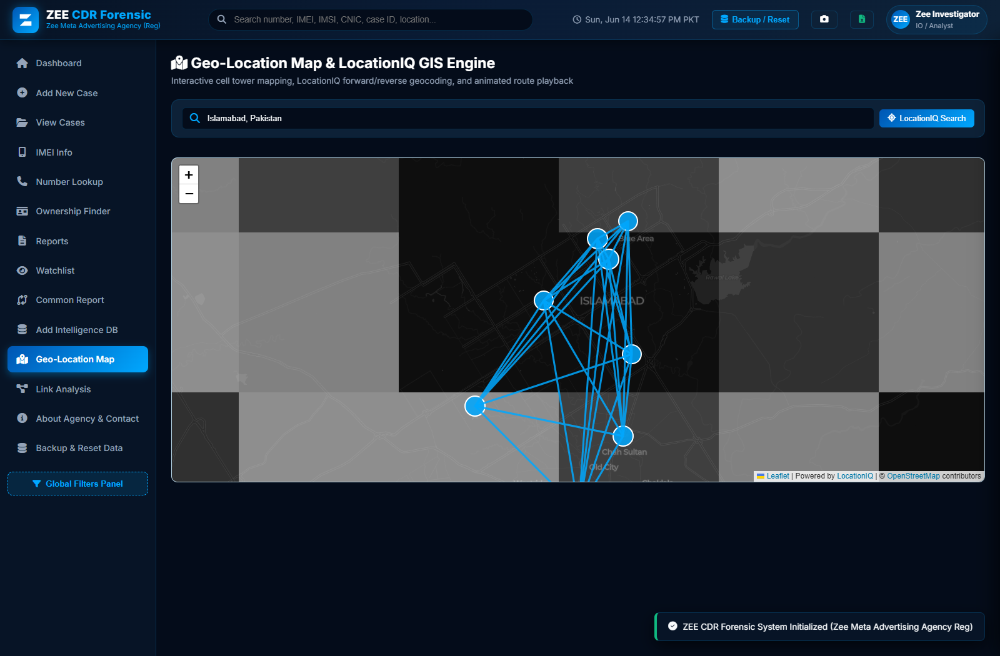
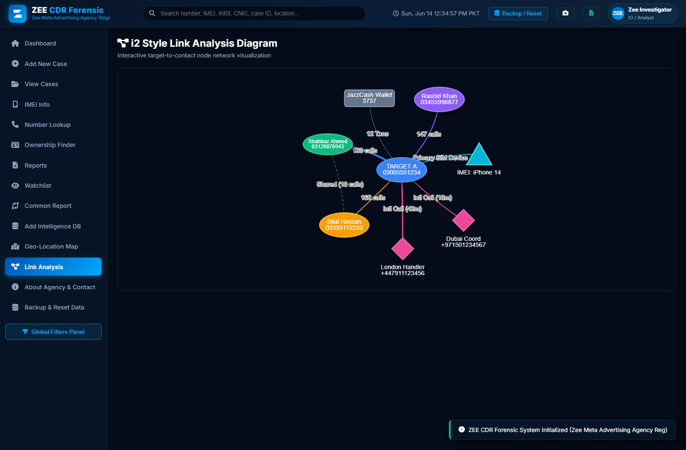
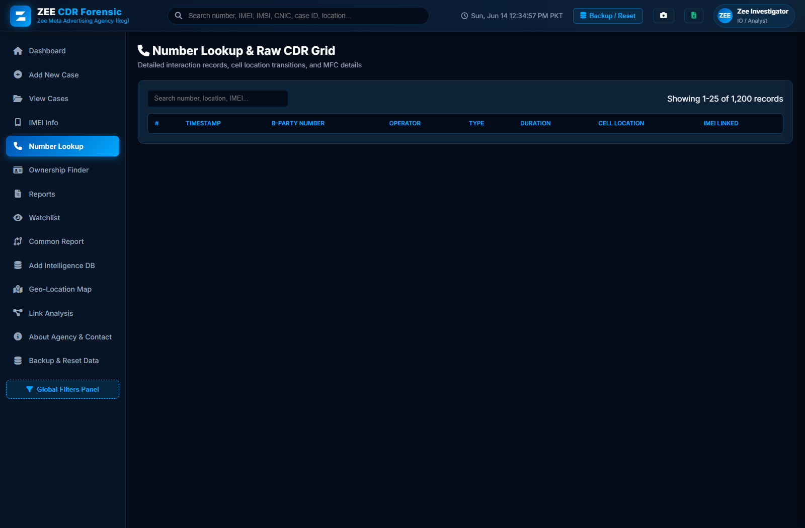

# ZEE CDR Forensic - Web Application & Developer Architecture Guide
**Zee Meta Advertising Agency (Reg) - Forensic Intelligence Division**

---

## 🌐 MULTI-LINGUAL DOCUMENTATION INDEX / فہرست / الفهرس

0. [📸 Application Visual Showcase & Screenshots](#-application-visual-showcase--screenshots)
1. [English Documentation](#1-english-documentation)
   - 1.1 [Application Features & Overview](#11-application-features--overview)
   - 1.2 [Developer Architecture & Build Guide](#12-developer-architecture--build-guide)
   - 1.3 [Future Roadmap & Advanced Features](#13-future-roadmap--next-gen-features)
2. [اردو میں مکمل تفصیلات اور ڈیولپر گائیڈ](#2-اردو-میں-مکمل-تفصیلات-اور-ڈیولپر-گائیڈ)
   - 2.1 [سافٹ ویئر کی خصوصیات (Features)](#21-سافٹ-ویئر-کی-خصوصیات-features)
   - 2.2 [ڈیولپر گائیڈ (Developer Guide & Tech Stack)](#22-ڈیولپر-گائیڈ-developer-guide--tech-stack)
   - 2.3 [مستقبل کے جدید ترین فیچرز (Future Roadmap)](#23-مستقبل-کے-جدید-ترین-فیچرز-future-roadmap)
3. [الدليل الكامل باللغة العربية](#3-الدليل-الكامل-باللغة-العربية)
   - 3.1 [مميزات ومواصفات التطبيق (Features)](#31-مميزات-ومواصفات-التطبيق-features)
   - 3.2 [دليل المطور والبنية البرمجية (Developer Guide)](#32-دليل-المطور-والبنية-البرمجية-developer-guide)
   - 3.3 [خارطة الطريق والمميزات المستقبلية (Future Roadmap)](#33-خارطة-الطريق-والمميزات-المستقبلية-future-roadmap)

---

## 📸 Application Visual Showcase & Screenshots
*(Live Screenshots captured directly from the ZEE CDR Forensic Web Platform)*

| 1. Command Center Overview Dashboard | 2. Case Management Module |
|:---:|:---:|
|  |  |
| **ڈیش بورڈ:** 8 میٹرک کارڈز، پروگریس ڈونٹ، لائیو کلاک اور تجزیاتی گراف | **کیس مینجمنٹ:** رجسٹرڈ کیسز کی تفصیلات، ایف آئی آر اور ٹریٹمنٹ سوئچر |

| 3. Geo-Location GIS Map (LocationIQ Engine) | 4. Data Backup, Restore & Reset Center |
|:---:|:---:|
|  |  |
| **جیو لوکیشن میپ:** ڈارک ٹائلز، سیل ٹاورز، اینیمیٹڈ موومنٹ اور تلاش | **بیک اپ اور ریسیٹ:** مکمل JSON بیک اپ، ری اسٹور اور ڈیٹا کلئیر سنٹر |

| 5. i2-Style Link Analysis Diagram | 6. Raw CDR Smart Data Grid |
|:---:|:---:|
|  |  |
| **لنک انالیسس:** مشتبہ روابط، نوڈ نیٹ ورک اور سلائیڈ اوور انسپیکشن | **سمارٹ ڈیٹا گرڈ:** ٹیلی کام آپریٹرز، ڈائریکشن ایروز، فلٹر اور پیجینیشن |

---

## 1. ENGLISH DOCUMENTATION

### 1.1 Application Features & Overview
**ZEE CDR Forensic** is a full-stack law-enforcement Call Detail Record (CDR) forensic analysis & intelligence platform designed by **Zee Meta Advertising Agency (Reg)**.

#### Key Features:
- **AI Auto-Parsing CDR Engine**: Automatically ingests CSV/XLSX/TXT CDR files from Jazz, Zong, Ufone, Telenor, and SCO networks, parsing targets, timestamps, cell IDs, and IMEIs.
- **Command Center Dashboard**: 8 metric cards (Total Cases, Pending Cases, Completed Cases, Active Investigations, Total Uploaded CDRs, Analyzed Numbers, Common Numbers, Locations Tracked), 3 quick action cards, and live clock.
- **5 Analytical Visualizers**:
  1. *Investigation Progress*: Doughnut chart split by Pending (75%), Active (12.5%), and Completed (12.5%).
  2. *Most Active Cases*: Bar chart with custom event count tooltips (`Final (001) CDR Events: 13,484`).
  3. *Frequent Locations*: Green bar chart of top visited cell tower sectors.
  4. *Software Usage (Daily)*: 30-day dot-line graph of daily opening frequency.
  5. *Software Open Times (Hourly)*: Smooth wave curve showing peak app opening hours.
- **Raw CDR Smart Data Grid**: Movement direction indicators (North to South), MFC details, B-Party frequency counters, operator badges, sorting, search, and pagination.
- **Network & Ownership Intelligence**: Operator breakdown, CNIC lookup (NADRA replica DB), International country logs (🇬🇧 UK, 🇦🇪 UAE, 🇸🇦 Saudi Arabia), and service shortcodes auto-flagger (3737 JazzCash, 1122, 15).
- **IMEI & IMSI Forensic Error Fixer**: **Luhn check-digit algorithm** auto-corrects corrupted 15-digit CDR IMEIs and resolves device models (Apple iPhone 14 Pro, Samsung Galaxy S23, Xiaomi) via TAC lookup database.
- **Geo-Location GIS Engine & Route Playback**: Interactive Leaflet map with cell tower markers, polyline movement routes, animated playback controls (1x, 2x, 5x, 10x speed), travel distance/time telemetry, and missing date calendar heatmap.
- **i2-Style Link Analysis Diagram**: Vis-Network interactive target-to-contact node graph with clickable nodes opening a slide-over inspection drawer.
- **Multi-CDR Cross Analysis**: Automated multi-target overlap finder for shared B-party contacts, shared IMEIs, cell towers, and co-locations.
- **Data Backup, Restore & Reset Center**: 
  - **Full JSON Backup Download**: Exports cases, CDR logs, targets, and stats in timestamped JSON format.
  - **Backup Upload & Restoration**: Live file parser that validates and restores all cases and records into the active session and browser local storage.
  - **Permanent Data Reset / Wipe**: One-click complete memory wipe with safety confirmation dialog.
  - **Factory Demo Reload**: Instant restoration of initial demo cases and CDR logs for testing.
- **Multi-Format Export Engine**: SheetJS multi-tab Excel workbook generator, PDF case dossiers, Google Earth KML route exporter, and PNG screenshot capture.

---

### 1.2 Developer Architecture & Build Guide

#### Technology Stack:
- **Core Architecture**: Modular Vanilla JavaScript (ES6+), HTML5, CSS3.
- **Design System**: Dark Cyber Glassmorphism matching the **Zee Meta Advertising Agency Invoice Color Palette** (`#040c1a`, `#071426`, `#0d2137`, `#007bff`, `#00a8ff`, `#9333ea`).
- **CDN Libraries Included**:
  - `Leaflet.js (v1.9.4)` - GIS mapping, cell tower rendering & polyline animation.
  - `Vis-Network` - Interactive i2-style node graph rendering.
  - `Chart.js` - Data visualization graphs & heatmaps.
  - `SheetJS (xlsx.full.min.js)` - In-browser Excel reading & multi-sheet workbook export.
  - `html2canvas (v1.4.1)` - Full DOM canvas rendering for PNG screenshots.
  - `FontAwesome (v6.4.0)` - High-definition iconography.

#### Project Directory Structure:
```
c:\Users\hp\Documents\CDR App\
├── index.html                 # Master HTML structure, views, modals, drawers & CDNs
├── css/
│   └── styles.css             # Zee Invoice Dark Glassmorphic stylesheet & responsive grid
└── js/
    ├── app.js                 # Main router, view switcher, event bus & toast notifications
    ├── data.js                # CDR data store, CNIC DB, TAC DB, Luhn algorithm & generator
    └── modules/
        ├── overview.js        # Command center metrics & 5 Chart.js visualizers
        ├── cases.js           # Case CRUD management & case treatment switcher
        ├── advance_cdr.js     # Target summary & watchlist telemetry
        ├── graphical_analysis.js # 24h timeline, duration split & 24x7 matrix heatmap
        ├── raw_cdr.js         # Smart Data Grid with pagination, search & movement arrows
        ├── intelligence.js    # Operator chart, CNIC lookup & shortcodes flagger
        ├── forensic_imei.js   # Luhn IMEI error fixer & SIM swap timeline
        ├── geolocation.js     # Leaflet GIS map, route playback engine & calendar gap heatmap
        ├── link_analysis.js   # Vis-Network i2 node diagram & slide-over drawer
        ├── multi_cross.js     # Multi-target cross comparison engine
        ├── exporter.js        # Multi-tab Excel, PDF, CSV, KML & PNG export engine
        └── backup_manager.js  # JSON backup exporter, live importer, and data reset engine
```

---

### 1.3 Future Roadmap & Next-Gen Features
To take **ZEE CDR Forensic** to the next level of law-enforcement capabilities, the following features can be added:

1. **AI Predictive Co-Location & Anomaly Detection**:
   - Integrate machine learning models (TensorFlow.js) to predict suspect movement trajectories and flag hidden co-location meetings automatically.
2. **Live Telecom Base Station (Tower Cell ID) API**:
   - Connect live API feeds (OpenCellID / Unwired Labs) for instant 3G/4G/5G tower Cell ID lat/lng resolution worldwide.
3. **Social Media & WhatsApp CDR Cross-Correlation**:
   - Cross-reference CDR phone numbers against WhatsApp, Telegram, Facebook, and Instagram OSINT profile databases.
4. **3D GIS Drone Elevation & Flight Path Simulation**:
   - Upgrade Leaflet GIS to CesiumJS or Three.js for 3D terrain elevation and line-of-sight analysis between cell towers.
5. **Real-Time Cloud Multi-Investigator Collaboration**:
   - Integrate Firebase / Node.js WebSocket backend to enable multi-analyst real-time case sharing and end-to-end encrypted evidence storage.

---

## 2. اردو میں مکمل تفصیلات اور ڈیولپر گائیڈ

### 2.1 سافٹ ویئر کی خصوصیات (Features)
**ZEE CDR Forensic** ایک انتہائی جدید، پروفیشنل لا نافذ کرنے والے اداروں اور فارنزک انویسٹی گیشن کے لیے تیار کردہ ویب ایپلیکیشن ہے جسے **زی میٹا ایڈورٹائزنگ ایجنسی (رجسٹرڈ)** نے تیار کیا ہے۔

#### بنیادی خصوصیات:
- **اے آئی آٹو پارسنگ سی ڈی آر انجن**: جاز، زونگ، یوفون، ٹیلی نار اور ایس سی او کے تمام خام سی ڈی آر (CSV/XLSX/TXT) کو خودکار طور پر پڑھ کر ٹارگٹ، ٹائم اسٹیمپ، سیل آئی ڈی اور IMEI کی شناخت کرتا ہے۔
- **کمانڈ سینٹر ڈیش بورڈ**: 8 میٹرک کارڈز (کل کیسز، زیرِ التواء کیسز، مکمل کیسز، ایکٹیو تحقیقات، اپ لوڈ شدہ CDRs، تجزیہ شدہ نمبرز، مشترکہ نمبرز، ٹریک شدہ لوکیشنز)، 3 کوئیک ایکشن کارڈز اور لائیو کلاک۔
- **5 اینالیٹیکل چارٹس**:
  1. *تحقیقاتی پیشرفت*: ڈونٹ چارٹ (Pending 75.0%, Active 12.5%, Completed 12.5%)۔
  2. *سب سے زیادہ ایکٹیو کیسز*: بار چارٹ بمعہ انٹرایکٹو ٹول ٹپ (`Final (001) CDR Events: 13,484`)۔
  3. *بار بار وزٹ کی گئی لوکیشنز*: گرین بار چارٹ۔
  4. *روزانہ سافٹ ویئر کا استعمال*: 30 دنوں کا لائن چارٹ۔
  5. *گھنٹوں کے لحاظ سے استعمال*: پرپل ویو کرِو چارٹ۔
- **را سی ڈی آر سمارٹ ڈیٹا گرڈ**: ٹرانزیشن ایروز (Movement Direction)، MFC تفصیلات، آپریٹر بیجز، سرچ، فلٹر، اور پیجینیشن۔
- **نیٹ ورک اور آنرشپ انٹیلی جنس**: **نادرا CNIC اونرشپ لُک اپ**، انٹرنیشنل کال فلیگز (🇬🇧 UK, 🇦🇪 UAE)، اور ہیلپ لائن شارٹ کوڈز (3737 JazzCash, 1122, 15) ڈٹیکٹر۔
- **IMEI اور IMSI فارنزک ایرر فکسر**: **Luhn check-digit algorithm** جو 15-ہندسوں کی غلط IMEI کی اصلاح کر کے TAC ڈیٹا بیس سے ڈیوائس ماڈل (iPhone 14 Pro, Samsung S23, Xiaomi) معلوم کرتا ہے۔
- **جی آئی ایس جیو لوکیشن اور اینیمیٹڈ روٹ پلے بیک**: Leaflet میپ بمعہ سیل ٹاورز، **1x تا 10x سپیڈ سے اینیمیٹڈ مشتبہ موومنٹ پلے بیک**، فاصلہ، اور Missing Date Switch-Off Calendar۔
- **i2-سٹائل لنک انالیسس ڈایاگرام**: Vis-Network پر مبنی انٹرایکٹو نیٹ ورک ڈایاگرام جس پر کلک کرنے سے سلائیڈ پینل کھلتا ہے۔
- **ملٹی سی ڈی آر کراس انالیسس**: متعدد مشتبہ افراد کا باہمی موازنہ اور مشترکہ بی پارٹی کنٹیکٹس و کو-لوکیشن کی خودکار شناخت۔
- **ڈیٹا بیک اپ، اپلوڈ اور ریسیٹ سنٹر**:
  - **فل بیک اپ ڈاؤنلوڈ**: تمام کیسز، سی ڈی آر ریکارڈز، لوکیشنز اور انٹیلی جنس کا ایک کلک پر جامع JSON بیک اپ حاصل کریں۔
  - **بیک اپ اپلوڈ اور بحالی (Restore)**: سابقہ بیک اپ فائل کو ایپلیکیشن اور براؤزر کی لوکل اسٹوریج میں فوراً بحال کریں۔
  - **مکمل ڈیٹا ریسیٹ (Wipe All Data)**: تصدیقی ڈائیلاگ کے ساتھ تمام ڈیٹا صاف اور ریسیٹ کرنے کی سہولت۔
  - **ڈیمو ڈیٹا کی دوبارہ لوڈنگ**: ٹیسٹنگ کے لیے اصل فیکٹری ڈیمو ڈیٹا کو ایک کلک میں دوبارہ حاصل کریں۔
- **ملٹی فارمیٹ ایکسپورٹ**: SheetJS ملٹی ٹیب ایکسل ورس شیٹ، پی ڈی ایف کیس رپورٹس، گوگل ارتھ KML روٹ فائل، اور PNG اسکرین شاٹ کپچر۔

---

### 2.2 ڈیولپر گائیڈ (Developer Guide & Tech Stack)

#### استعمال شدہ ٹیکنالوجیز:
- **بنیادی فن تعمیر**: Modular Vanilla JavaScript (ES6+), HTML5, CSS3۔
- **ڈیزائن سسٹم**: **Zee Meta Advertising Agency Invoice Color Palette** (`#040c1a`, `#071426`, `#0d2137`, `#007bff`, `#00a8ff`, `#9333ea`) پر مبنی ڈارک سائیبر گلاس مورفزم۔
- **شامل شدہ CDN لائبریریاں**:
  - `Leaflet.js` - جیو گرافک میپنگ، سیل ٹاورز اور موومنٹ پلے بیک۔
  - `Vis-Network` - انٹرایکٹو i2 نیٹ ورک ڈایاگرام۔
  - `Chart.js` - اینالیٹیکل چارٹس اور گراف۔
  - `SheetJS (xlsx)` - ایکسل فائل ریڈنگ اور ملٹی شیٹ ایکسپورٹ۔
  - `html2canvas` - ہائی ڈیفینیشن اسکرین شاٹ کپچر۔
  - `FontAwesome` - پروفیشنل سیکیورٹی آئیکنز۔

---

### 2.3 مستقبل کے جدید ترین فیچرز (Future Roadmap)
اس سافٹ ویئر کو مزید جدید اور عالمی معیار کا بنانے کے لیے درج ذیل فیچرز شامل کیے جا سکتے ہیں:

1. **اے آئی پریڈکٹو کو-لوکیشن اور انوملی ڈٹیکشن**:
   - مشین لرننگ الگورتھمز کی مدد سے مشتبہ افراد کی آئندہ موومنٹ کی پیشگوئی اور خفیہ ملاقاتوں کی خودکار نشان دہی۔
2. **لائیو ٹیلی کام بیس سٹیشن (Cell ID) API**:
   - عالمی سطح پر 3G/4G/5G سیل ٹاورز کے عین لائیو لوکیشن اور Lat/Lng معلوم کرنے کے لیے OpenCellID API کا انضمام۔
3. **سوشل میڈیا اور واٹس ایپ کراس ریلیشن**:
   - سی ڈی آر نمبرز کو واٹس ایپ، ٹیلیگرام، فیس بک اور انسٹاگرام پروفائلز کے ساتھ خودکار میچ کرنا۔
4. **3D GIS ڈرون ایلیویشن اور تھری ڈی ویو**:
   - Leaflet کو CesiumJS یا Three.js پر شفٹ کر کے تھری ڈی ٹوپوگرافی اور ٹاورز کے درمیان لائن آف سائیٹ اینالیسس۔
5. **رئیل ٹائم کلاؤڈ ملٹی یوزر کولابوریشن**:
   - Firebase یا Node.js WebSocket بیک اینڈ بنا کر متعدد تحقیقاتی افسران کو ایک ساتھ رئیل ٹائم میں کیس شیئرنگ کی سہولت فراہم کرنا۔

---

## 3. الدليل الكامل باللغة العربية

### 3.1 مميزات ومواصفات التطبيق (Features)
تطبيق **ZEE CDR Forensic** هو منصة متكاملة للتحليل الجنائي لسجلات تفاصيل المكالمات (CDR) والاستخبارات الرقمية، تم تطويره بواسطة **وكالة زي ميتا للإعلانات (المسجلة)**.

#### المميزات الرئيسية:
- **محرك تحليل الذكاء الاصطناعي لسجلات CDR**: تحليل تلقائي لسجلات شبكات Jazz و Zong و Ufone و Telenor و SCO واستخراج الأرقام المستهدفة والأوقات والمعرفات.
- **لوحة قيادة مركز التحكم**: 8 بطاقات قياسية (إجمالي القضايا، القضايا المعلقة، القضايا المكتملة، التحقيقات النشطة، سجلات CDR المرفوعة، الأرقام المحللة، الأرقام المشتركة، المواقع المتتبعة)، و 3 بطاقات إجراءات سريعة وساعة حية.
- **5 مخططات تحليلية بيانية**:
  1. *تقدم التحقيق*: مخطط دائرية (معلقة 75%، نشطة 12.5%، مكتملة 12.5%).
  2. *أكثر القضايا نشاطاً*: رسم بياني شريطي مع تفاصيل تفاعلية (`Final (001) CDR Events: 13,484`).
  3. *المواقع الأكثر تكراراً*: رسم بياني بالأعمدة الخضراء.
  4. *استخدام البرنامج اليومي*: رسم بياني لمدى استخدام التطبيق خلال 30 يوماً.
  5. *أوقات فتح البرنامج بالساعات*: منحنى موجي بنفسجي.
- **شبكة البيانات الذكية لسجلات CDR**: مؤشرات اتجاه الحركة (من الشمال إلى الجنوب)، تفاصيل MFC، عدادات تكرار الأرقام، شارات المشغل، الفرز، البحث، والترقيم.
- **استخبارات الشبكة والملكية**: توزيع المشغلين، البحث عن ملكية الهوية الوطنية (NADRA DB)، سجلات المكالمات الدولية (🇬🇧 المملكة المتحدة، 🇦🇪 الإمارات)، والمكتشف التلقائي للأرقام المختصرة الخدمية (3737 JazzCash, 1122, 15).
- **مصلح أخطاء IMEI و IMSI الجنائي**: استخدام **خوارزمية Luhn** لتصحيح أخطاء أرقام IMEI التالفة المكونة من 15 رقماً واستخراج طراز الجهاز (Apple iPhone 14 Pro, Samsung S23, Xiaomi) عبر قاعدة بيانات TAC.
- **مُحرك الخرائط الجغرافية GIS وتشغيل المسار**: خريطة Leaflet تفاعلية تظهر أبراج الاتصالات، مسارات الحركة، **تشغيل أنيميشن مسار المشتبه به بسرعات (1x, 2x, 5x, 10x)**، حساب المسافات، وتقويم التواريخ المفقودة.
- **مخطط تحليل الروابط التفاعلي (أسلوب i2)**: رسم بياني تفاعلي من Vis-Network يربط الهدف بالأرقام والأجهزة مع لوحة تفاصيل منزلقة عند النقر.
- **التحليل التقاطعي متعدد السجلات**: كشف تلقائي للأرقام المشتركة والأجهزة والأبراج المتداخلة والتواجد في نفس الموقع بين عدة مشتبه بهم.
- **مركز النسخ الاحتياطي واستعادة وإعادة تعيين البيانات**:
  - **تنزيل نسخة احتياطية كاملة (JSON)**: تصدير كافة القضايا وسجلات المكالمات والهويات والإحصائيات بملف JSON مختوم بالوقت.
  - **رفع واستعادة النسخة الاحتياطية**: استيراد وتطبيق النسخ الاحتياطية فورياً وحفظها في التخزين المحلي للمتصفح.
  - **مسح وإعادة تعيين البيانات بالكامل**: مسح فوري لكافة السجلات مع نافذة تأكيد أمنية لتجنب الحذف العرضي.
  - **إعادة تحميل البيانات التجريبية المصنعية**: زر مخصص لاستعادة بيانات العرض الأصلية بنقرة واحدة لأغراض الاختبار.
- **محرك التصدير متعدد الصيغ**: تصدير ملفات Excel متعددة الصفحات عبر SheetJS، تقارير PDF جنائية، ملفات مسار KML لـ Google Earth، والتقاط صور PNG.

---

### 3.2 دليل المطور والبنية البرمجية (Developer Guide)

#### التقنيات المستخدمة:
- **البنية الأساسية**: Vanilla JavaScript (ES6+), HTML5, CSS3 بدون تعقيدات خارجية.
- **نظام التصميم**: تصميم زجاجي جنائي داكن متناسق مع **لوحة ألوان فاتورة وكالة زي ميتا للإعلانات** (`#040c1a`, `#071426`, `#0d2137`, `#007bff`, `#00a8ff`, `#9333ea`).
- **المكتبات المضمنة (CDNs)**:
  - `Leaflet.js` - الخرائط الجغرافية ومحاكاة الحركة.
  - `Vis-Network` - رسم شبكات الروابط التفاعلية i2.
  - `Chart.js` - المخططات البيانية والتحليلية.
  - `SheetJS` - قراءة وتصدير ملفات Excel.
  - `html2canvas` - التقاط صور الشاشة عالية الدقة.
  - `FontAwesome` - الأيقونات الجنائية والأمنية.

---

### 3.3 خارطة الطريق والمميزات المستقبلية (Future Roadmap)
لترقية **ZEE CDR Forensic** إلى أعلى مستويات التكنولوجيا الاستخباراتية، يمكن إضافة المميزات التالية مستقبلاً:

1. **التنبؤ بالذكاء الاصطناعي للتواجد المشترك واكتشاف الشذوذ**:
   - دمج نماذج التعلم الآلي للتنبؤ بمسارات الحركة المستقبلية وكشف الاجتماعات السرية بين المشتبه بهم تلقائياً.
2. **الربط المباشر مع واجهة برمجية لأبراج الاتصالات (Cell ID API)**:
   - الاتصال بقواعد بيانات OpenCellID للحصول على إحداثيات أبراج 3G/4G/5G الحية حول العالم.
3. **الربط التقاطعي مع وسائل التواصل الاجتماعي وواتساب**:
   - مطابقة أرقام CDR تلقائياً مع حسابات واتساب وتليجرام وفيسبوك وإنستغرام.
4. **محاكاة الخرائط ثلاثية الأبعاد وارتفاعات الدرون (3D GIS)**:
   - الترقية إلى CesiumJS أو Three.js لتحليل التضاريس ثلاثية الأبعاد وخط الرؤية بين الأبراج.
5. **التعاون السحابي الحي بين المحققين (Real-Time Cloud Collaboration)**:
   - بناء خادم خلفي باستخدام Firebase أو Node.js WebSockets للسماح لعدة محققين بالعمل على نفس القضية في وقت واحد مع تشفير كامل للأدلة.

---
**Zee Meta Advertising Agency (Reg)** | Call/WhatsApp: +92 300 7467676 | +92 333 6003596
